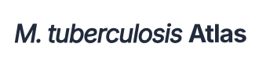
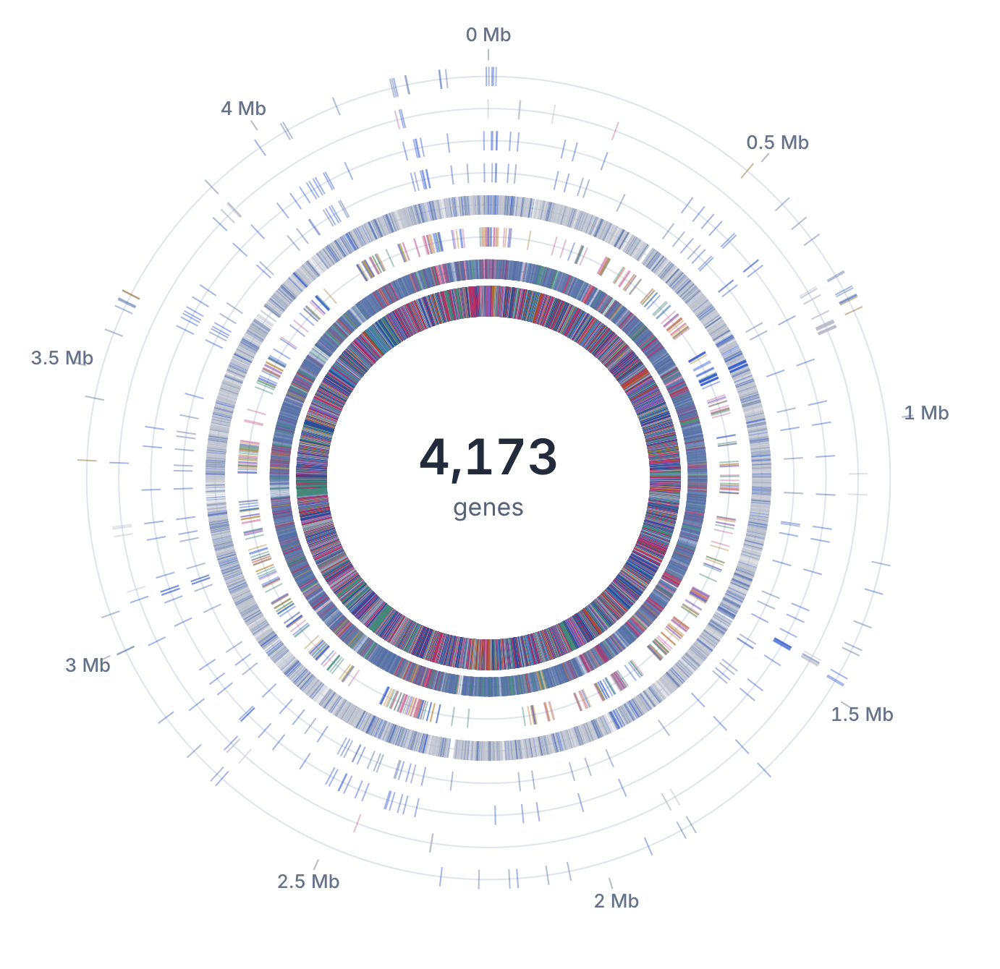

<p align="center">
  
</p>

M. tuberculosis Atlas is a research application for exploring public evidence about
*Mycobacterium tuberculosis* H37Rv drug targets. It connects genes to genetic
studies, protein structures, compound activity, screening experiments, resistance
mutations, drugs and clinical trials.

Start with a gene, a compound or a research question. Compare the available
evidence, follow it back to its source, and see where measurements are missing.

<p align="center">
  
</p>

<p align="center"><em>The genome explorer shows evidence across H37Rv, with each gene positioned along the chromosome.</em></p>

## Explore the atlas

| View | What you can do |
| --- | --- |
| **Genome** | Browse genes on the circular genome or in a sortable table. Filter by essentiality, vulnerability, structures, chemistry and other evidence, then open a gene’s detailed record. |
| **Targets** | Build a target cohort by combining criteria. See which genes meet each criterion and which have no recorded evidence. |
| **Screens** | Explore published screening campaigns, their assay stages and compound results, including inactive and inconclusive outcomes. |
| **Hit profiling** | Review the experiments associated with a compound, from whole-cell potency to selectivity, ADME, pharmacokinetics and in-vivo studies where available. |
| **Drugs & trials** | Look up TB drugs and candidates, their recorded mechanisms and linked clinical trials. |
| **Map** | Follow recorded relationships between genes, compounds, drugs, screens and biological concepts. Each connection identifies the type of evidence behind it. |

Search spans genes, compounds, drugs, trials and screens. Individual records have
shareable URLs. Gene details include sequence context, experimental and predicted
structures, and interactive molecular viewers.

**Ask the atlas** accepts questions in plain language, queries the dataset and
returns an answer with links to relevant records. For example:

- Which essential genes have a structure but no recorded ligands?
- What evidence supports inhA as a target?
- How do dprE1 and mmpL3 compare across the available evidence?
- Which trials test drugs linked to a particular target?

Answers use a configurable language model and should be checked against the
underlying records. Browsing and filtering work without a model service.

## Data and interpretation

The atlas uses public databases and published studies. Its sources include
Mycobrowser, UniProt, NCBI RefSeq, ChEMBL, PubChem BioAssay, UniChem, RCSB PDB,
AlphaFold DB, STRING, the WHO mutation catalogue, ClinicalTrials.gov and MtbTnDB.
Published essentiality, CRISPRi and conditional-fitness datasets add experimental
evidence about gene function and vulnerability.

Source tables record the source name, version and retrieval date. The app’s
**Sources & licences** page lists the releases included in a build and their reuse
terms. Dataset counts depend on those releases; run `make summary` to inspect
your local build.

A few distinctions matter when reading the results:

- **Missing evidence:** an empty field means the atlas has no matching record in
  its included data. It does not establish that an experiment has never been done.
- **Target activity and whole-cell activity:** activity against a protein,
  evidence from a related protein and activity against the organism are labelled
  separately. Whole-cell potency alone does not identify a molecular target.
- **Genetic evidence:** essentiality and vulnerability depend on the experiment,
  strain and growth conditions. An unmeasured condition is kept separate from a
  measured lack of effect.
- **Drug links:** a stated mechanism, membership of a protein complex and a
  resistance association describe different relationships.
- **Screening coverage:** the included campaigns are a subset of the published
  screening record. Source selection and identifier mapping affect which results
  can be linked to an H37Rv gene.

The atlas is intended for research, not medical advice or treatment decisions.

## Run locally

You need Python 3.12 or later, `uv`, Node.js 22 or later, npm and Make.

```sh
git clone https://github.com/sidxz/mtb-atlas.git
cd mtb-atlas
make install
npm ci --prefix web
make build
```

The first build downloads the source data and writes the normalized dataset to
`data/store/`. It can take substantial time, especially for screening results.
Downloads are cached in `data/raw/` for subsequent builds. Neither directory is
committed to the repository, and the data pipeline needs no language-model key.

Start the API and frontend in separate terminals, from the repository root:

```sh
make api
```

```sh
make web
```

Open [localhost:5173](http://localhost:5173). The frontend proxies API requests to
port 8099; the API reference is at [localhost:8099/docs](http://localhost:8099/docs).

### Enable Ask the atlas

Copy [.env.example](.env.example) to `.env` and configure a model provider.
Supported backends are Anthropic, OpenRouter, Ollama and OpenAI-compatible
services. The example file documents model settings, Turnstile, optional ORCID
sign-in and question limits.

For local development, `ATLAS_ASK_LIMITS=off` allows questions without Turnstile or
ORCID. Keep limits enabled on a public instance. To load `.env` locally, start the
API with this command in place of `make api`:

```sh
uv run uvicorn atlas.api:app --reload --port 8099 --env-file .env
```

Evaluate a configured model against the atlas’s reference questions with
`uv run atlas eval-ask`. The CLI reads environment variables from your shell;
export the model settings before running it.

## How it works

The Python pipeline downloads and normalizes source records, maps identifiers to
H37Rv loci, and writes Parquet tables. DuckDB queries those tables through a
FastAPI service. The React and TypeScript frontend reads the API, with Mol* for
protein structures, IGV for sequence context and browser-based RDKit for compound
depictions.

| Directory | Contents |
| --- | --- |
| [`atlas/`](atlas/) | Data pipeline, queries, API, authentication and question answering |
| [`atlas/sources/`](atlas/sources/) | Source-specific download and normalization code |
| [`web/`](web/) | React application and frontend tests |
| [`tests/`](tests/) | Python tests and committed data fixtures |

### Refresh the data

```sh
make check                    # Check for upstream releases
make refresh SOURCE=chembl     # Refresh one source and dependent tables
make diff                     # Review changes against the previous store
make summary                  # Inspect the current dataset
```

A refresh saves the previous store in `data/store.prev/`. Review the diff before
replacing a deployed dataset. These commands run independently of the language
model service.

### Run checks

```sh
make test                     # Python tests against local fixtures
make lint                     # Python lint and formatting checks
npm test --prefix web         # Frontend logic tests
npm run build --prefix web    # TypeScript checks and production frontend build
```

## Deploy

The container image `ghcr.io/sidxz/mtb-atlas` serves the frontend at `/` and the API
at `/api`. It contains the application; the dataset is mounted separately.

After building `data/store/` and configuring `.env`, run:

```sh
docker compose -f docker-compose.prod.yml up -d
```

The supplied [Compose configuration](docker-compose.prod.yml) mounts the store
read-only and serves the app at [localhost:8099](http://localhost:8099).
[.env.example](.env.example) lists the deployment settings, including the public
URL, operator details and authentication credentials.

When using a reverse proxy, set `FORWARDED_ALLOW_IPS` to the proxy’s address or
subnet so question limits count visitors correctly. Anonymous questions require
Turnstile and a configured `ATLAS_SECRET`; ORCID sign-in is optional. Model and
access settings are required for question answering, while the browsing views
remain available without them.

To publish a data update, refresh the store, review the diff, replace the mounted
dataset and restart the container. A data-only update does not require rebuilding
the application image.

## Licence

The application code is released under the [MIT licence](LICENSE). Source data
retains its original licences and attribution requirements. Consult the app’s
**Sources & licences** page before redistributing data or derived datasets.
